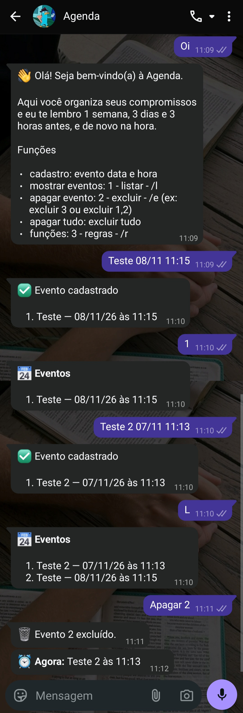

# Agenda WhatsApp

**Seus compromissos no WhatsApp, com lembrete na hora certa.**

Uma agenda que mora onde as pessoas já estão. Você escreve o compromisso numa
mensagem, ele é cadastrado na hora, e o bot avisa 1 semana, 3 dias e 3 horas antes,
e de novo na hora.

```
Você:  dentista 25/08 14h
Bot:   ✅ Evento cadastrado

       1. dentista — 25/08/26 às 14:00
```

<p align="center">
  
</p>

---

## O problema

Compromissos se perdem. Anotar no papel, abrir um aplicativo de calendário, lembrar de
configurar o alarme: cada passo é um motivo para deixar para depois, e a consulta, a
entrega ou a reunião passa.

Todo mundo, porém, abre o WhatsApp todos os dias.

## A solução

A Agenda WhatsApp transforma uma conversa em agenda.

- **Cadastrar é escrever.** `dentista 25/08 14h` e pronto. Aceita `15/8`, `25-08`,
  `25/08/26`, `14h`, `9h30` e `14:30`.
- **Vários de uma vez.** Uma mensagem com várias linhas cadastra um compromisso por linha.
- **Lembretes que chegam sozinhos.** 1 semana, 3 dias e 3 horas antes, e de novo na hora,
  no mesmo chat.
- **Cada pessoa com a sua agenda.** A lista de cada um é só dela, no privado.
- **Sem aplicativo novo.** Quem já usa WhatsApp já sabe usar.

## Como a pessoa usa

| Comando | O que faz |
|---|---|
| `dentista 25/08 14h` | cadastra um compromisso |
| várias linhas | cadastra um compromisso por linha |
| `listar` ou `1` | mostra os compromissos |
| `excluir 3` ou `excluir 1,2` | apaga pela posição na lista |
| `excluir tudo` | apaga todos os seus compromissos |
| `regras` ou `3` | mostra os comandos |

## Feita para ser confiável

- **Só atende quem você autoriza.** A conversa de cada pessoa é reconhecida, e o envio
  é travado nas conversas permitidas.
- **Lembrete dado como enviado só depois de entregue.** Se a conexão cair, o lembrete
  tenta de novo na volta seguinte.
- **Trava de segurança no envio.** Mais de 8 mensagens em 60 segundos bloqueiam o envio,
  protegendo o número contra excesso.
- **Reconhece as próprias mensagens.** Tudo o que o bot envia volta pelo webhook, e ele
  distingue o que é dele do que é da pessoa.
- **Falhas registradas.** O webhook sempre responde com sucesso, e qualquer falha vai
  para o log, sem derrubar o atendimento.

## Importante saber

- A conexão com o WhatsApp é feita pela Evolution API, que usa o WhatsApp Web e não é a
  API oficial. Para uso comercial em escala, o caminho é a API oficial do WhatsApp
  Business.
- Números novos podem ter o envio automático limitado por alguns dias depois de muitas
  mensagens seguidas.
- Os horários seguem o fuso da máquina onde o bot roda.

## Por dentro

Python 3.12 · FastAPI · SQLAlchemy · SQLite · asyncio · Evolution API (Docker,
PostgreSQL, Redis). O agendador roda junto com a API, em `asyncio`, e os testes não
usam banco real nem rede. O desenvolvimento, sprint por sprint, está em [`docs/`](docs/).

## Quem faz

Desenvolvido e mantido por **Cassia Cristina**. Quer a Agenda WhatsApp no seu negócio,
ajustada ao seu fluxo e com suporte? Fale comigo pelo
[GitHub](https://github.com/CassiaCristina0o).
